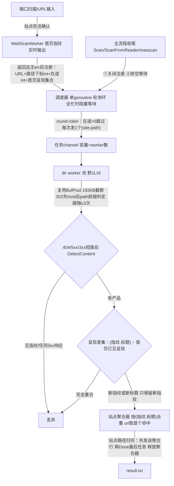

# 04-目录扫描模块

## 定位

指纹识别的目录层补充：用内置路径字典探测存活站点的隐藏后台与 Web 应用（/seeyon/、/druid/login.html 这类二级路径入口），对响应做指纹识别并入结果。不是通用目录爆破器——字典是指纹导向精选（70 条），判定是指纹过滤，输出是资产行。

## 关键决策（为什么）

1. **调度单元反转（(站点,路径)对 + round-robin 轮询环）**：朴素实现"扫完站点 A 全部路径再扫 B"对单站点等效集中轰炸；总并发闸门（WebScanRateCtrlCh）控制全局吞吐，拦不住 60 并发全打一个站点。per-site 在途门闩（>0 跳过）用三个 int 的代价实现单站点在途 ≤1、多站点时间交错。
2. **两阶段停机协议**：调度器不因"暂时无活站点"退出（站点是流水线中渐进注册的，"现存全完成"不等于"不会再有"）；主流程收尾先"关闭注册"再"排空"，杜绝 send-on-closed-channel 竞争与站点静默丢失。在途递减与 LogWG.Done 一律 defer 化（panic-safe）。
3. **三层判定（404/5xx/3xx 短路 → 302 同源同前缀跟随 → 首页呈现差集）**：404/5xx 与 **3xx** 短路直接丢——3xx 教训来自真机误报（拒绝跟随时 302 响应的 Location/Server 头会被引擎匹配出无关产品，如 Location 含 "thinkphp" 字样误报 thinkphp）；跟随成功的落地响应状态码才进判定，401/403 保留（后台访问控制强信号）。其余状态码过 DetectContent（吃原始响应含响应头），有产品才输出——200 型软 404（自定义 404 页返回 200）匹配不出产品名，天然免疫。301/302 先判 host（变化即丢弃）再判 path 前缀（/druid → /druid/login.html 跟随，/randompath → /login 丢弃）——发射端过滤，管流量。输出前做（指纹,标题）二元组呈现差集（路径呈现与首页已见呈现集合完全重合则不打印，出现新指纹或新标题才输出）——出口端过滤，管正确性：软 404 落地页必然是首页扫描已访问过的页面、呈现完全相同，即使漏拦误报也出不了出口；二元组（而非纯指纹）是为了救回"同产品后台入口"（WordPress /wp-admin 与首页同指纹不同标题——path.txt 通用路径的核心价值场景）。401/403 的价值靠响应头特征（如 Tomcat Manager 的 realm）抓住。
4. **站点聚合输出 + 复用 Product 行格式**：url 带路径即区分来源，下游解析脚本零适配；聚合器按（指纹+标题）站点内去重、url 取首个命中路径，生命周期 = 单站点目录扫描时长，内存峰值只与在环站点数相关。顺序契约：聚合行先 LogSuccess 发送、后 Done 最后任务（防 close(Results) 后发送 panic）。
5. **注册点 = WebScanWorker 返回后，err 不注册**：连接不可达的站点注册只会白等 70 次超时（9s×70≈10.5 分钟）并拖死收尾。DoWebScan 会被跳转链重入（scanType 1/3），且首页扫描链在途时同 host 目录请求受 MaxConnsPerHost=1 排队挤占超时。首页呈现集合（首页扫描链全部调用的（指纹,标题）并集）经 DoWebScan 指纹收集路径改造后随注册带入——现状指纹拼进输出串即弃，需增加返回值/收集器。
6. **默认关闭（-dir 显式开启）**：目录扫描使目标请求量放大约 70 倍，属重大行为变化。
7. **字典 go:embed**：与指纹库一致的分发形态，VPS 单二进制无需带字典文件。path.txt 为 CRLF 行尾、末行无换行，解析必须 TrimSpace。

## 架构数据流

## 关键功能怎么做

- **注册**：WebScanWorker 返回且无 err 时按最终确认存活的 URL 去重注册，覆盖端口扫描派生 / `-u,-uf` / `-std,-msc` 三类入口；`-m webpoc` 模式不经 WebScanWorker，`-dir` 静默无效；`-dp` 域名注册 http/https 两站点（同后端双倍目录流量，与首页扫描行为一致的预期）。
- **调度器**：切片存站点 + mutex；循环找"在途==0 且路径未扫完"的站点发射任务；无站点可发射且未停机时阻塞等待（在途归零唤醒），禁止自旋；只响应两阶段停机（关闭注册 → 排空），不因暂时无活退出。
- **worker**：GET site/path → ReadRawWithSize 模式读原始响应 → 404/5xx/3xx 短路（3xx 含拒绝跟随的 302 本身与限跳截断的落地 3xx）→ 302 判定（先 host 后 path 前缀，违规不跟随）→ 跟随落地响应 DetectContent → 与首页呈现集合做二元组差集（完全重合丢弃，有新指纹/新标题则保留）→ 命中进聚合器；在途递减与 LogWG.Done defer 化。
- **收尾**：主流程各模式末尾先关闭注册、再等调度器排空，最后才 StopAndWait，防 main 提前退出与 panic。
- **client**：目录扫描专用 http.Client（共享现有 Transport，自带 Timeout=WebTimeout，CheckRedirect 限 3 次）。

## 机制/表设计

无持久化结构。运行态仅：站点轮询环（每站点约 50B）、任务 channel（容量=worker 数）、聚合器（仅有效命中，站点级生命周期）。
