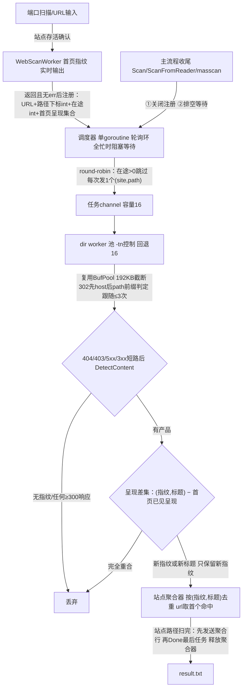

# 04-目录扫描模块

## 定位

指纹识别的目录层补充：用内置路径字典探测存活站点的隐藏后台与 Web 应用（/seeyon/、/druid/login.html 这类二级路径入口），对响应做指纹识别并入结果。不是通用目录爆破器——字典是指纹导向精选（70 条），判定是指纹过滤，输出是资产行。

## 关键决策（为什么）

1. **调度单元反转（(站点,路径)对 + round-robin 轮询环）**：朴素实现"扫完站点 A 全部路径再扫 B"对单站点等效集中轰炸；总并发闸门（WebScanRateCtrlCh）控制全局吞吐，拦不住 60 并发全打一个站点。per-site 在途门闩（>0 跳过）用三个 int 的代价实现单站点在途 ≤1、多站点时间交错。
2. **两阶段停机协议**：调度器不因"暂时无活站点"退出（站点是流水线中渐进注册的，"现存全完成"不等于"不会再有"）；主流程收尾先"关闭注册"再"排空"，杜绝 send-on-closed-channel 竞争与站点静默丢失。在途递减与 LogWG.Done 一律 defer 化（panic-safe）。
3. **三层判定（3xx/4xx/5xx 短路 → 302 同源同前缀跟随 → 首页呈现差集）**：状态码 ≥300 全屏蔽（仅 2xx 参与识别）——3xx 教训来自真机误报（拒绝跟随时 302 响应的 Location/Server 头会被引擎匹配出无关产品，如 Location 含 "thinkphp" 字样误报）；4xx 全屏蔽是用户逐轮取舍（403/404 噪声实证在先，401 仅极少数产品可识别、价值低）。跟随成功的落地响应状态码才进判定。2xx 过 DetectContent（吃原始响应含响应头），有产品才输出——200 型软 404（自定义 404 页返回 200）匹配不出产品名，天然免疫。301/302 先判 host（变化即丢弃）再判 path 前缀（/druid → /druid/login.html 跟随，/randompath → /login 丢弃）——发射端过滤，管流量。输出前做（指纹,标题）二元组呈现差集（路径呈现与首页已见呈现集合完全重合则不打印，出现新指纹或新标题才输出；**空标题例外**——"None" 是占位符不算真实标题差异，空标题路径退化为纯指纹差，全部指纹为首页已见则丢）——出口端过滤，管正确性：软 404 落地页必然是首页扫描已访问过的页面、呈现完全相同，即使漏拦误报也出不了出口；二元组（而非纯指纹）是为了救回"同产品后台入口"（WordPress /wp-admin 与首页同指纹不同标题——path.txt 通用路径的核心价值场景）。
4. **站点聚合输出 + 复用 Product 行格式**：url 带路径即区分来源，下游解析脚本零适配；聚合器按（指纹+标题）站点内去重、url 取首个命中路径，生命周期 = 单站点目录扫描时长，内存峰值只与在环站点数相关。顺序契约：聚合行先 LogSuccess 发送、后 Done 最后任务（防 close(Results) 后发送 panic）。
5. **注册点 = WebScanWorker 返回后，err 不注册**：连接不可达的站点注册只会白等 70 次超时（9s×70≈10.5 分钟）并拖死收尾。DoWebScan 会被跳转链重入（scanType 1/3），且首页扫描链在途时同 host 目录请求受 MaxConnsPerHost=1 排队挤占超时。首页呈现集合（首页扫描链全部调用的（指纹,标题）并集）经 DoWebScan 指纹收集路径改造后随注册带入——现状指纹拼进输出串即弃，需增加返回值/收集器。
6. **默认关闭（-dir 显式开启）**：目录扫描使目标请求量放大约 70 倍，属重大行为变化。
7. **字典 go:embed**：与指纹库一致的分发形态，VPS 单二进制无需带字典文件。path.txt 为 CRLF 行尾、末行无换行，解析必须 TrimSpace。

## 架构数据流



## 关键功能怎么做

- **注册**：WebScanWorker 返回且无 err、且首页链至少一次响应 body 完整时按最终确认存活的 URL 去重注册——body 全黑洞（头回 body 超时）的站点不注册：同一服务器的目录路径必然同样超时（入口拦截，用户洞察 2026-11-14；任何一次 body 完整即健康，跳转后正常的站点不误伤）。覆盖端口扫描派生 / `-u,-uf` / `-std,-msc` 三类入口；`-m webpoc` 模式不经 WebScanWorker，`-dir` 静默无效；`-dp` 域名注册 http/https 两站点（同后端双倍目录流量，与首页扫描行为一致的预期）。
- **调度器**：切片存站点 + mutex；循环找"在途==0 且路径未扫完"的站点发射任务；无站点可发射且未停机时阻塞等待（在途归零唤醒），禁止自旋；只响应两阶段停机（关闭注册 → 排空），不因暂时无活退出。
- **worker**：数量由 `-tn`（WebScanThreadNum）控制、与 web 扫描并发一致（BL-DIR-003）；非法值（≤0，含单测零值）回退 16。GET site/path → ReadRawWithSize 模式读原始响应 → 状态码 ≥300 短路（3xx 含拒绝跟随的 302 本身与限跳截断的落地 3xx；4xx/5xx 全屏蔽，用户逐轮取舍）→ 302 判定（先 host 后 path 前缀，违规不跟随）→ 跟随落地 2xx 响应 DetectContent → 与首页呈现集合做二元组差集（完全重合丢弃，有新指纹/新标题则保留；空标题退化为纯指纹差）→ 命中进聚合器；在途递减与 LogWG.Done defer 化。
- **熔断（双阈值对称）**：连续 3 次请求**失败**（超时/连接失败/body 黑洞，任何有效响应清零）与连续 3 条**慢路径**（>2s，快路径清零）各自独立熔断跳过剩余路径并提示——前者防半死站点 70×超时拖尾，后者防"慢而成功"型站点（真机实证：avg 5.1s/条、70 slow、仅 1 failed 的慢速响应/WAF 深检形态，失败熔断抓不住）拖死收尾；偶发 1-2 条慢的正常站点与稳定 1s/条的限速型站点（未超 2s）不受影响。abort 提示行**仅终端不落盘**（BL-DIR-003：量大，不进 result.txt；-silent 时完全静默）。
- **慢站点画像**：每路径耗时统计；站点扫完且**纯路径耗时总和** >10s 打一行画像（url/路径数/总耗时/avg/最慢/慢条数/失败条数）——以纯耗时而非墙钟跨度判定（多站点轮询均摊下正常站点跨度≈总扫描时长，墙钟判定会满屏假象行）。**输出经用户决策暂时注释**（2026-11-14 慢站点定性完成、连续慢熔断落地后）：统计逻辑与 slowSiteLine 函数保留，dirscan.go 的 complete 内恢复注释块即可重新启用。
- **进度**：progressLoop 每 30s 且有新进展打一行快照（paths done / sites pending / findings）；时间驱动而非百分比——站点渐进注册分母不单调，恒定速率不刷屏、快扫描不可见。进度行**仅终端不落盘**（BL-DIR-003；-silent 时完全静默）。
- **收尾**：主流程各模式末尾先关闭注册、再等调度器排空（含 workers.Wait 等全部 worker 退出，聚合行先于返回发出），最后才 StopAndWait，防 main 提前退出与 panic。
- **client**：目录扫描专用 http.Client（共享现有 Transport，自带 Timeout=WebTimeout，CheckRedirect 限 3 次）。

## 使用行为说明（时序与输出，使用者视角）

### 参数

- `-dir`：开关，默认关。开启后对每个经 Web 扫描确认存活的站点做目录探测；关闭时注册/停机全部直通返回，行为与无此功能完全一致（零侵入）。
- `-dirf`：外部路径字典，覆盖内置字典（`Plugins/dirlist.txt`，70 条指纹导向精选）。每行一个路径，空行与 `#` 注释行跳过，自动清洗行尾空白（CRLF 兼容）；加载失败（不存在/为空）即时提示并降级为不扫描。

### 工作流程与时序

```
端口扫描（进行中）
  └─ 发现存活 web 站点 → 首页指纹行照常实时输出（不受目录扫描影响）
       └─ 站点当场注册进轮询环（打印 dirscan enabled）→ 目录探测立即开始，与剩余端口扫描并行
            └─ 该站点全部字典路径探测完成 → 一次性输出聚合结果（0~几行 Product 行）→ 释放聚合器
主流程收尾 → 关闭注册 → 排空剩余目录任务 → 打印 dirscan done 统计
```

**输出粒度是站点级聚合**：一个站点要等它自己的全部字典路径扫完才输出该站点的发现（同呈现的多条路径合并为一行，url 取首个命中路径）；多个站点之间交错探测、先扫完的站点先输出、互不等待。目录扫描总时长（站点数×字典条数）通常远大于端口扫描，目录结果行集中在扫描时间线后段出现——这是聚合粒度的预期行为，**不是**"端口扫描结束后才开始"（注册与探测在端口扫描期间并行进行，可从 `dirscan enabled` 行早于 `alive ports` 统计得到验证）。`-dir` 开启时普通模式的 `[*] ok: 1/1` 结尾行跳过——它走 Printf 直写终端会插队到仍在 Results 通道排队的目录行之前，体感错乱。

### 输出示例（实测）

```
[+] Product http://127.0.0.1:18081     200 (Directory listing for /)         [directory], [pythonsimplehttp], [python]
[*] dirscan enabled: 1 sites registered, 70 paths per site
[+] Product http://127.0.0.1:18081/seeyon/     200 (Directory listing for /seeyon/)     [jsp], [python], [oracle-java], ...
[+] Product http://127.0.0.1:18081/admin        200 (Directory listing for /admin/)     [python], [pythonsimplehttp], [directory]
[+] Product http://127.0.0.1:18081/jeecg-boot/  200 (Directory listing for /jeecg-boot/) [pythonsimplehttp], [directory], ...
[*] dirscan done: 1 sites x 70 paths, 3 findings
[+] alive ports(1): 18081
[*] scan done! cost: 178.8808ms
```

### 流量与资源行为

- **流量均摊**：调度按"(站点,路径)对"交错——任意时刻单站点在途请求 ≤1，多站点轮流探测，不把字典流量集中轰在单个站点（朴素实现"扫完站点A再扫B"等效于对每站点顺序压测）；总请求量约为 站点数×字典条数，扫描总时长相应增加属预期；**慢/半死站点有双熔断兜底**（连续 3 次请求失败或连续 3 条路径 >2s 即放弃该站点剩余路径并提示），最坏拖尾从 70×超时 收敛到 3×超时。
- **超时**：完全跟随 web 扫描（`-wt`，默认 9s）——client 总超时与 Transport 的连接/TLS/响应头超时同源派生，单条请求硬上限 9s。
- **内存**：站点聚合器只存有效命中，站点扫完输出后立即释放，内存峰值只与同时在扫的站点数相关（几十 KB 量级）；`-dp` 域名会注册 http/https 两个站点，同后端时目录流量双倍（与首页扫描行为一致）。

### 已知行为与边界

- 默认关闭：请求量放大约 70 倍属重大行为变化，须显式 `-dir`。
- `-m webpoc` 模式不经 Web 扫描，`-dir` 在该组合下静默无效。
- Ctrl+C 中断时该站点尚未输出的聚合发现会丢失（站点聚合相对实时输出的固有取舍）；`-msc` 模式第二次 Ctrl+C 强退同理。
- 指纹输出顺序非确定（指纹引擎 map 迭代，pre-existing）：同一命中行每次运行指纹排列可能不同，集合一致。

## 机制/表设计

无持久化结构。运行态仅：站点轮询环（每站点约 50B）、任务 channel（容量固定 16，worker 数由 -tn 控制不相随——调度器单协程，缓冲深度只影响发送阻塞时机）、聚合器（仅有效命中，站点级生命周期）。
