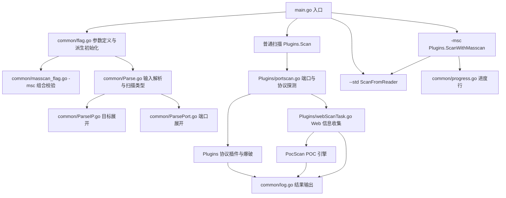

# 设计总览

fscanx 是面向内网的综合扫描工具，用 Go 编译成单文件：一条命令完成存活探测、端口扫描、协议指纹与口令爆破、Web 指纹和 POC（漏洞验证脚本）检测；既能直接扫描目标网段，也能从标准输入接收 `ip:port`/masscan 输出，或自己拉起 masscan 联动扫描。

上次全面核对：2026-11-13

## 技术栈

- **语言与交付**：Go，单二进制，无数据库、无常驻服务端。
- **命令行**：标准库 `flag`；全局配置集中在 `common` 包。
- **并发**：`alitto/pond` 协程池 + 三个并发控制通道（Web 探测、插件、口令爆破）；`juju/ratelimit` 控制 ICMP 发包。
- **识别能力**：`gonmap` 做端口协议指纹，`mylib/finger` 做 Web 指纹，`PocScan` 兼容 xray YAML POC。
- **运行模式**：普通扫描、`--std` 标准输入管线、`-msc` masscan 内嵌联动。

## 系统架构

## 模块能力地图

- **01 命令行参数**（[模块文档](modules/01-命令行参数模块.md)）：定义全部 flag、默认值与派生初始化；在 `common.Parse` 前校验 `-msc` 组合；把 `-h/-hf/-u/-uf` 的输入交给解析层，并决定 `-std/-msc` 的运行模式。目标格式展开在 ParseIP，端口组/区间展开在 ParsePort。
- **02 资源与内存控制**（[模块文档](modules/02-资源与内存控制模块.md)）：约束扫描过程的内存上界：HTTP 短连接、池化缓冲区返回前拷贝、响应体读取限长（指纹 192KB / POC 4MB / redis 16KB）、协程池按需扩容与空闲回收；qqwry unix 下 mmap 按需映射（无查询时 RSS 近零）；日志写出不逐行 fsync 不用 bufio（直写内核页缓存）。
- **03 masscan 联动**（[模块文档](modules/03-masscan联动模块.md)）：`-msc` 模式查找并启动 masscan，转换目标/端口参数，流式读取结果送入 `--std` 管线，并在终端底部维护进度行；fscanx 独占终端输出。`-msc -auto` 组合下先按原逻辑智能探活筛存活 C 段，清单留存 `.msc/` 后交给 masscan 只扫存活段。
- **04 目录扫描**（[模块文档](modules/04-目录扫描模块.md)）：`-dir` 开启的指纹导向目录探测——轮询环调度器按"(站点,路径)对"交错发射（单站点在途≤1），两阶段停机（Seal→Drain）；内置路径字典（`-dirf` 覆盖）；四道判定闸（状态码 ≥300 全短路→302 同源同前缀→指纹非空→(指纹,标题)呈现差集）；双熔断（连续 3 次失败 / 连续 3 条 >2s 慢路径）；站点聚合后以同构 Product 行输出，聚合器站点级生命周期。
- **05 指纹库质量**（[模块文档](modules/05-指纹库质量模块.md)）：治理 fingers 与 goby 两库数据质量——fingers 库已裁剪为 hash-only（519 条，文本特征误报清零，文本指纹职责移交 goby）；goby 库治理回显自证（扫描路径被软404页回显进响应体导致路径特征自证，判据=特征路径 ∈ dirlist）与 mega-OR 污染条目（多产品子规则误合并）；维护工作流：明文编辑→`go run ./mylib/finger/cmd/pack` 重打包→validate 校验。

## 核心业务流

1. **参数与派生初始化**：`common.Flag` 注册参数并 `flag.Parse`；随后 `ValidateMasscanMode` 拒绝非法组合，再按 `-std/-msc` 选择并发模型并创建协程池。
2. **输入解析**：`common.Parse` 读取用户、密码、URL、端口文件等输入；`ParseScantype` 按 `-m` 改写端口集合；`ParseInput` 末尾计算并创建 ICMP 令牌桶；`ProcessDomainAsURL` 在 `-dp` 下把纯域名展开为 http/https URL。
3. **扫描调度**：普通扫描先做存活/端口判断，再按端口→插件、协议→插件分派；`--std` 与 `-msc` 共用 `ScanFromReader`，边读目标边探测。
4. **输出**：插件结果统一进入 `common/log.go` 的 `Results` 通道，由 `SaveLog` 输出到终端并按需写文件；`-msc` 的日志在进度行上方打印。

## 仍在生效的关键设计决策

- 扫描器面向海量异构目标，HTTP 一律短连接，不复用 keep-alive（模块 02）。
- 池化缓冲区返回调用方前必须拷贝，池对象即取即还（模块 02，BL-MEM-001）。
- 所有网络响应读取必须有长度上限，gzip 解压路径单独计算上限（模块 02，BL-MEM-002）。
- masscan 以子进程运行，fscanx 独占终端；只解析其 stdout/stderr，不依赖 `-y`（模块 03，BL-MSC-001）。
- `-msc` 与 `-std/-dp/-u/-uf/-m icmp` 互斥；`-margs` 禁止覆盖托管的 masscan 参数（模块 03）。
- `-msc -auto` 组合：探活（AutoScanBigCidr 原逻辑零改动）与 masscan 端口扫描接力——探活产物留存 `.msc/`（时间戳名，不自动清理，可 `masscan -iL` 复跑）；组合跳过后续 icmp 全 IP 验活（masscan SYN 扫覆盖 IP 级发现，`-np` 无作用）；探活目标只来自 `-h`（拒 `-hf`），0 存活提示后退出 0（模块 03，BL-MSC-004）。
- `-msc` 不设置 `ScanWithStdInput`；两者只共用 `usesStdinLikePipeline` 做派生初始化（模块 01/03）。
- 目录扫描默认关闭且零侵入：`-dir` 未启用时注册/停机全部直通返回；启用后单站点在途 ≤1（轮询环门闩），输出判定用（指纹,标题)呈现差集、输出带完整指纹（判定与输出解耦，模块 04，BL-DIR-001）。
- fingers 引擎无 AND 逻辑（对照 goby 布尔表达式 / ehole·fingerprinthub 数组内 AND），指纹误报治理走数据层：弱特征删除优先于引擎改造；大小写重复指纹属数据冗余非误报（模块 05，BL-FP-001）。
- 日志写出不逐行 fsync 不用 bufio，WriteString 直写内核页缓存（模块 02，BL-MEM-003）。

## 文档导航

- [项目控制台](项目控制台.md)：当前阶段、活跃 item、阻塞项、下一步。
- [当前实现总览](当前实现总览.md)：代码目录与现有能力。
- [模块文档](modules/)：模块定位、关键决策与流程。
- [Backlog](backlog/)：item 状态唯一事实源；已验收项保留在模块索引与 [CHANGELOG](CHANGELOG.md)。
- [执行计划](../plans/)：非平凡任务的执行记录。
